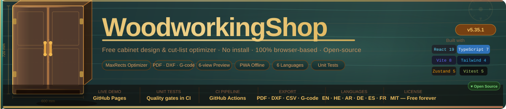
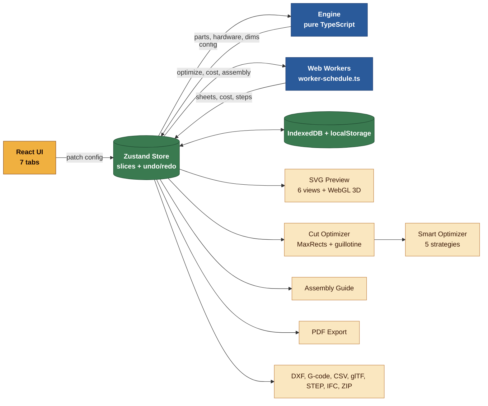
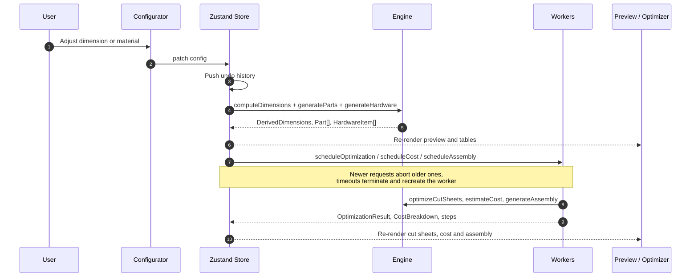
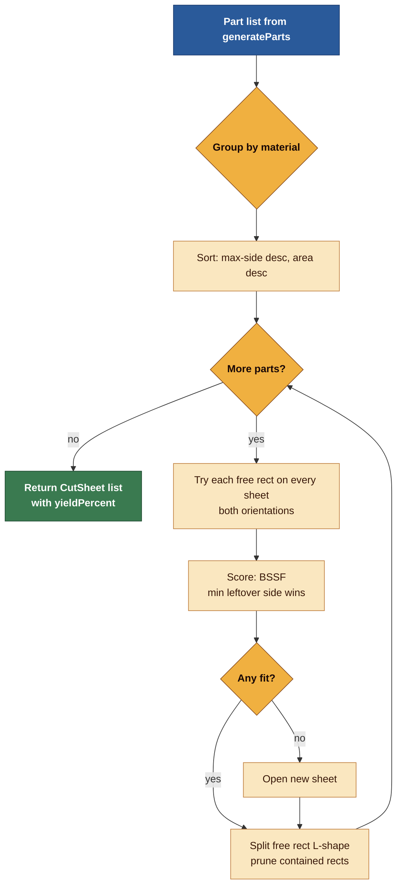
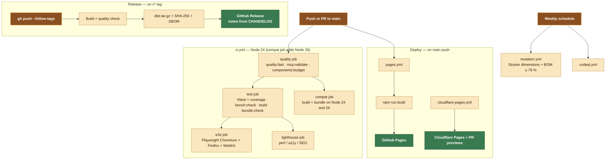
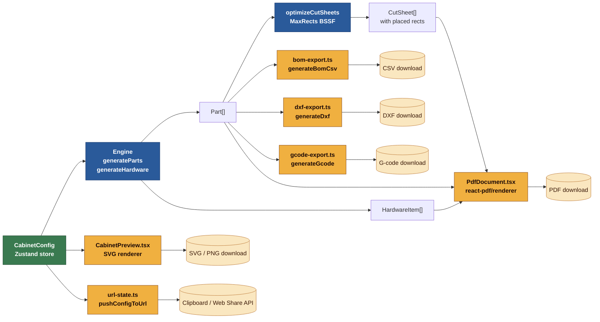
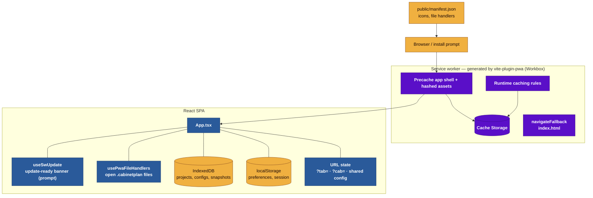
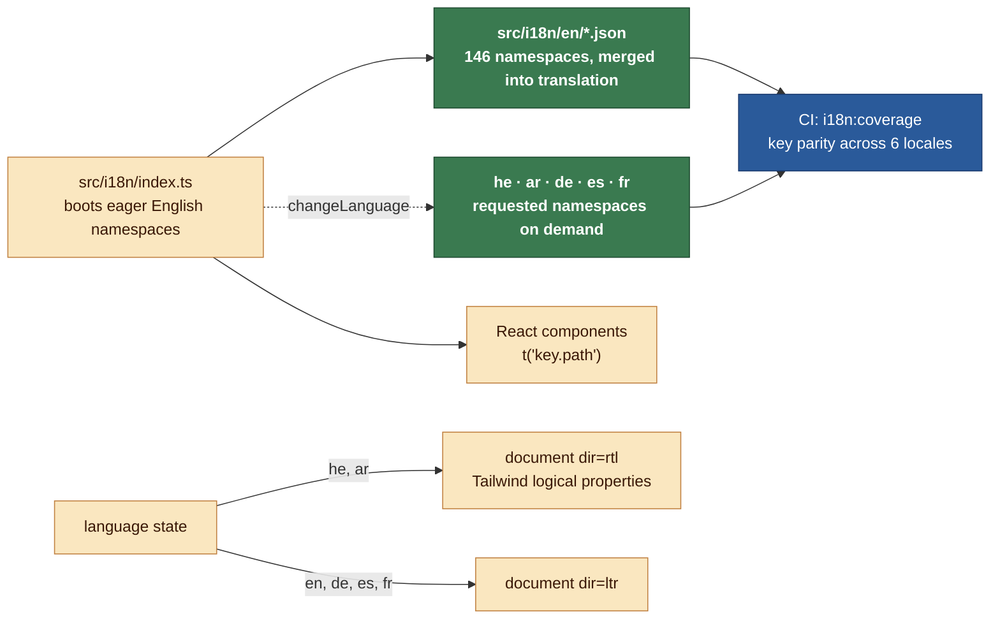
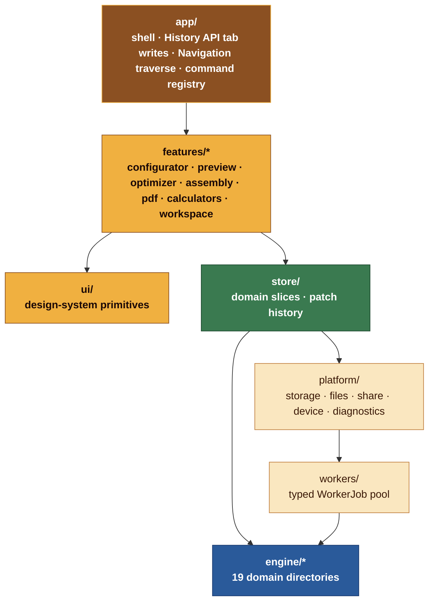

# 🏛 Architecture

<div align="center">
  
</div>

WoodworkingShop is a client-side React SPA (no backend). All computation — dimensions, parts, hardware, cut-sheet optimization, cost estimation — runs in the browser.

> **Module reference** — For competitive positioning, product strategy, and sprint planning see [ROADMAP.md](../ROADMAP.md). For user-facing feature descriptions see [USER-GUIDE.md](USER-GUIDE.md).

## ⚡ High-Level Data Flow



## 📁 Directory Layout

Measured for Sprint 434. The Phase 82 layout below is the current tree, not a proposal. Do not recreate `src/components/`.

```text
src/
├── main.tsx                 # React 19 entry point
├── App.tsx                  # Root: 7 tabs, keyboard shortcuts, lazy panels, error boundaries
├── index.css                # Tailwind v4 theme (wood-* tokens), print styles, RTL support
├── app/                     # Shell: header, onboarding, command palette (13 .tsx, 5 .ts)
├── features/                # Panels (120 .tsx, 18 .ts)
│   ├── configurator/        # Config panel, presets, materials, room layout
│   ├── preview/             # SVG views, isometric, WebGL 3D panel
│   ├── optimizer/           # Cut sheets, smart optimizer, tables, G-code preview
│   ├── assembly/            # Step-by-step guide, build log
│   ├── pdf/                 # Document orchestrator + sections/
│   ├── calculators/         # Lazy calculator panels
│   └── workspace/           # Home, sidebar, marketplace
├── ui/                      # Design-system primitives and shared icons (17 .tsx, 3 .ts)
├── engine/                  # Pure TypeScript computation — 189 .ts files, 19 domain directories
│   ├── core/ costing/ export/ geometry/ hardware/ materials/ optimizer/
│   ├── assembly/ calculators/ comparison/ inventory/ joinery/ project/ room/
│   ├── stock/ templates/ validation/ waste/ workshop/
│   └── index.ts             # Public barrel (domain re-exports plus the deprecated Web Serial facade)
├── store/                   # 22 .ts files: domain slices, patch history, worker schedule
├── platform/                # 29 .ts files: storage, files, share, device, diagnostics, worker scheduler
├── workers/                 # 9 .ts files: cut, cost, assembly, BOM, DXF
├── hooks/                   # 8 .ts files
├── i18n/                    # {en,he,ar,de,es,fr}/{namespace}.json — 146 namespaces per locale
├── services/                # 3 .ts files: store-aware diagnostics still awaiting a target owner
└── utils/                   # 35 .ts files: export helpers and compatibility facades

public/
├── manifest.json            # PWA manifest with file handlers
├── _headers · _redirects    # Cloudflare Pages security headers (CSP) and SPA fallback
├── offline.html · 404.html  # Offline and GitHub Pages fallbacks
├── robots.txt · sitemap.xml
└── fonts/                   # Self-hosted fonts

tests/                       # 465 files: 369 *.test.* files and 16 Playwright specs
├── engine/ store/ utils/ hooks/ services/ i18n/ platform/ workers/
├── components/              # Testing Library behaviour tests (historical coverage floor)
├── e2e/                     # Playwright journeys, accessibility, visual baselines
├── fixtures/                # Oracles, golden exports, project fixtures
├── bench/                   # Vitest benchmarks (budgets in config/bench-budget.json)
└── helpers.ts · assertions.ts · setup.ts

.github/
├── workflows/               # 15 workflows: CI, release, pages, CodeQL, mutation, Lighthouse, …
├── actions/setup-node/      # Composite checkout + Node + npm ci
├── agents/ prompts/ instructions/ skills/ hooks/   # Copilot assets (validated in quality)
├── ISSUE_TEMPLATE/ DISCUSSION_TEMPLATE/
├── CONTRIBUTING.md · SECURITY.md · GOVERNANCE-POLICY.md
└── dependabot.yml
```

### CNC Serial Ownership

`src/engine/workshop/webserial-v2.ts` owns the pure stream-session state machine.
`src/utils/webserial-cnc.ts` owns browser Web Serial I/O and is used by the
assembly panel. `src/engine/index.ts` still re-exports those browser helpers so
the v5.36.0 public barrel stays intact. That re-export is the one remaining
architecture violation. Do not remove it without a versioned public-API change.

## ⚙ Engine Module

The engine is a set of pure functions with no React dependency. All functions take a `CabinetConfig` and return derived data:

| Function            | Input                            | Output                                                       |
| ------------------- | -------------------------------- | ------------------------------------------------------------ |
| `computeDimensions` | `CabinetConfig`                  | `DerivedDimensions` (internal measurements, hinge positions) |
| `generateParts`     | `CabinetConfig`                  | `Part[]` (bilingual names, dimensions, edge banding)         |
| `generateHardware`  | `CabinetConfig`                  | `HardwareItem[]` (hinges, screws, cam locks, etc.)           |
| `optimizeCutSheets` | `Part[]`                         | `OptimizationResult` (sheet layouts, yield %, waste)         |
| `findOptimizations` | `CabinetConfig`                  | `OptimizationSuggestion[]` (5 strategies with scores)        |
| `estimateCost`      | `Part[], HardwareItem[], config` | `CostBreakdown` (per-material, hardware, total)              |

## 🗄 State Management

The main Zustand store (`cabinet-store.ts`) composes domain slices (`project`, `cabinets`, `catalog`, `optimizerSettings`, `ui`, `snapshot`, `namedExpressions`) and holds:

- **Project state**: array of `CabinetEntry` (name + config), active index
- **Derived state**: dimensions and parts computed synchronously; optimization, cost and assembly scheduled on Web Workers by `worker-schedule.ts` (abort, timeout and stale-result suppression)
- **Undo/redo**: structural patches in `slices/cabinetHistory.ts` (max 50 steps). Slider drags stay one step through `beginHistoryGroup` / `endHistoryGroup`
- **UI state**: active tab, dark mode, high contrast, colour-blind mode, unit system, focus mode

Satellite stores stay separate ([ADR-0006](decisions/0006-domain-store-slices.md)): `custom-materials-store.ts`, `custom-hardware-store.ts`, `room-store.ts`, `stock-tracker-store.ts`, and `cost-variance-store.ts` persist independently at version 1. `toast-store.ts` stays ephemeral. Session persistence uses `StorageAdapter` and writes versioned slices plus the legacy flat fields.

Saved projects, configurations, and snapshots use IndexedDB through `idb-keyval` in
`utils/indexed-db-storage.ts`. Existing localStorage project/config data migrates one-way on first
access; session state and UI preferences continue to use localStorage via `safe-persist-storage.ts`.

## 📦 Build & Deploy

- **Bundler**: Vite 8 (Rolldown) with React plugin + Tailwind CSS plugin
- **Code splitting**: every tab panel is `React.lazy`; `@react-pdf/renderer` is split into its own chunk via `manualChunks` and loaded on demand
- **Deploy targets**: GitHub Pages (base path `/WoodworkingShop/`) and Cloudflare Pages (edge CDN, PR previews, CSP headers from `public/_headers`)
- **PWA**: `vite-plugin-pwa` generates a Workbox service worker (`registerType: 'prompt'`); `useSwUpdate` shows the update-ready banner

Intermediate artifact policy:

- Generated caches and reports (Vite cache, ESLint cache, Vitest coverage output, Playwright test results/reports) are configured to write to OS TEMP (`%TEMP%/WoodworkingShop` on Windows).
- Workspace root should only contain source/config/documentation artifacts, not transient telemetry outputs.

## 🔗 SharedArrayBuffer & Cross-Origin Isolation

`SharedArrayBuffer` enables zero-copy memory sharing between the main thread and Web Workers. The cut-optimizer worker currently uses structured-clone transfer. A future optimisation could pass part data via a shared buffer to avoid serialisation overhead.

**Requirement**: `SharedArrayBuffer` is only available when the page is _cross-origin isolated_. This requires the server to send:

```text
Cross-Origin-Opener-Policy:  same-origin
Cross-Origin-Embedder-Policy: require-corp
```

**Current status**: GitHub Pages does **not** set these headers, so `crossOriginIsolated` is `false` there. Cloudflare Pages sends `Cross-Origin-Opener-Policy: same-origin` but not COEP. The utility function `trySharedArrayBuffer(size)` in `src/workers/shared-buffer.ts` detects this and returns `null`, allowing the worker pipeline to fall back to standard transfer automatically.

**To enable locally**: Add to `vite.config.ts` `server.headers`:

```ts
'Cross-Origin-Opener-Policy': 'same-origin',
'Cross-Origin-Embedder-Policy': 'require-corp',
```

## 🎮 WebGL 3-D Preview

The Preview tab mounts an interactive 3D panel (`Preview3DPanel`) beside the six SVG views. Sprint 440 plans a WebGPU renderer with a WebGL2 fallback.

**Feature probe** — `src/engine/webgl-probe.ts`:

| Function              | Description                                     |
| --------------------- | ----------------------------------------------- |
| `probeWebGLTier()`    | Returns `'webgl2' \| 'webgl1' \| 'unavailable'` |
| `isWebGLAvailable()`  | Quick boolean gate                              |
| `isWebGL2Available()` | Check for full shader support                   |

**Component** — `src/features/preview/WebGLPreviewCanvas.tsx`:

- Renders a simplified 3-D box approximating the configured cabinet dimensions.
- Uses raw WebGL (no external library) to keep bundle impact near zero.
- Falls back gracefully to a descriptive message if WebGL is unsupported.

> Roadmap items for realistic materials and the WebGPU path: [ROADMAP.md — Sprint 440](../ROADMAP.md).

## 🧩 Component Tree

```mermaid
graph TD
  App["App.tsx<br/>shortcuts · lazy panels · focus mode"]:::root

  Header["Header<br/>tabs, undo/redo, theme, language, units"]:::layout
  Sidebar["Sidebar<br/>cabinets, project summary, cost"]:::layout
  Shell["ToastContainer · OnboardingManager · ShortcutsModal"]:::layout

  subgraph Tabs["Seven tabs — each panel wrapped in an ErrorBoundary"]
    Workspace["Workspace<br/>welcome banner"]:::tab
    Config["Configurator<br/>ConfiguratorPanel + RoomLayoutView"]:::config
    Preview["Preview<br/>CabinetPreview (6 SVG views) + Preview3DPanel"]:::view
    Optimizer["Cut Sheets<br/>ProjectSummary · SmartOptimizer · Parts/Hardware tables · OptimizerView"]:::tab
    Assembly["Assembly<br/>AssemblyGuide + build log"]:::tab
    PDF["PDF Export<br/>PdfExportPanel + glTF/STEP/IFC"]:::tab
    Calc["Calculators<br/>24 lazy calculator panels"]:::tab
  end

  subgraph ConfigParts["Configurator sections"]
    Presets["Quick presets"]:::sub
    Dims["Dimensions + toe kick"]:::sub
    Mat["Materials + custom catalog"]:::sub
    Doors["Doors + drawers + shelves"]:::sub
    Expr["Named expressions"]:::sub
  end

  App --> Header
  App --> Sidebar
  App --> Shell
  App --> Workspace
  App --> Config
  App --> Preview
  App --> Optimizer
  App --> Assembly
  App --> PDF
  App --> Calc
  Config --> Presets
  Config --> Dims
  Config --> Mat
  Config --> Doors
  Config --> Expr

  classDef root fill:#8b5022,stroke:#f0b040,color:#ffffff,font-weight:bold
  classDef layout fill:#d4860a,stroke:#8b5022,color:#1a0806
  classDef config fill:#2a6a4a,stroke:#1a4030,color:#ffffff,font-weight:bold
  classDef sub fill:#e0f5ea,stroke:#4a9a6a,color:#1a3a28
  classDef view fill:#2a5a9a,stroke:#1a3a6e,color:#ffffff,font-weight:bold
  classDef tab fill:#7a3a10,stroke:#c08040,color:#fae7c0
```



## 🔄 State Flow



## ✂ Cut Optimizer Pipeline

The cut optimizer uses a Maximal Rectangles (MaxRects) algorithm with the
Best Short Side Fit (BSSF) heuristic. Parts are queued in descending
max-side order, then each part probes every free rectangle on every open
sheet in both orientations before opening a new sheet.



## 🚀 CI/CD Pipeline



Planned (Phase 81): SHA-pinned actions, sharded E2E with blocking visual snapshots, build attestations and an OpenSSF Scorecard workflow.

## 📤 Export Pipeline



## 📱 PWA Architecture



Sprint 315 browser acceptance is complete: Chromium/Firefox cover offline app-shell reload, storage
pressure, and valid/malformed `.cabinetplan` handling. Native OS-level file launch remains unverified
and is explicitly outside browser-level acceptance.

## 🌐 i18n Architecture



All six locales have exact key parity with no missing, extra, empty, or placeholder-mismatched values.
EN-identical rates are 1.02% (HE), 1.20% (AR), 1.38% (DE), 1.34% (ES), and 1.66% (FR), all below
the 2% limit. Human review remains for four diagnostic-string records covering 76 keys.

## ♿ Accessibility (WCAG 2.2 AA)

WoodworkingShop targets **WCAG 2.2 Level AA** compliance. This section documents the patterns, CI gates, and runtime mechanisms in place.

### Compliance Target

| Standard | Level | Status                         |
| -------- | ----- | ------------------------------ |
| WCAG 2.2 | AA    | ✅ Enforced in CI via axe-core |
| WCAG 2.1 | AA    | ✅ (subset of 2.2)             |
| WCAG 2.2 | AAA   | ⚠ Partial (not fully targeted) |

### CI Gate — axe-core + Playwright

`tests/e2e/accessibility.spec.ts` runs on every CI run against the production build:

1. Launches the built app with `@playwright/test`
2. Injects `@axe-core/playwright` with tags `wcag2a`, `wcag2aa`, `wcag21a`, `wcag21aa` and `wcag22aa`
3. Fails the pipeline on any violation

Coverage: all seven tabs × six locales × light/dark themes, plus mobile navigation and onboarding, the shortcuts dialog, project manager, invalid-import errors, G-code export preview and optimizer loading/error recovery (Sprint 316). A keyboard-only journey covers skip link, focus visibility, tab order and dialog focus return.

### Focus Management

| Pattern                | Location                                                                                                                          |
| ---------------------- | --------------------------------------------------------------------------------------------------------------------------------- |
| **Focus trap**         | `useFocusTrap` hook — shared by every modal dialog; ignores negative-tabindex elements and restores focus to the trigger on close |
| **Skip-to-main**       | `index.html` — `<a href="#main-content">` skip link at the top of the DOM, translatable via `a11y.skipToContent` i18n key         |
| **Tab order**          | All interactive elements follow logical DOM order; `tabIndex` is only used for hidden inputs (`tabIndex={-1}`)                    |
| **Keyboard shortcuts** | `?` = shortcuts modal, `Ctrl+Z` / `Ctrl+Y` = undo/redo, `Alt+1`–`Alt+6` = tabs, `Alt+D` = dark mode, `Ctrl+Shift+K` = focus mode  |

### Visual Accessibility

| Feature                      | Implementation                                                                                                                                      |
| ---------------------------- | --------------------------------------------------------------------------------------------------------------------------------------------------- |
| **High-contrast mode**       | `.high-contrast` CSS class on the app root wrapper, toggled via the `toggleHighContrast()` store action and persisted with UI preferences.          |
| **Color-blind mode**         | `colorBlindMode` store toggle adds deuteranopia-friendly palette (amber → blue shift) for cut-sheet diagrams                                        |
| **`prefers-reduced-motion`** | CSS `@media (prefers-reduced-motion: reduce)` disables all transitions and animations (`transition: none !important`, `animation: none !important`) |
| **`prefers-color-scheme`**   | Dark mode auto-detected on first load via `detectOsDarkMode()`, persisted to localStorage                                                           |
| **Minimum contrast**         | Tailwind design tokens use `wood-600` (#5A3E28) on white, which exceeds 4.5:1 contrast ratio                                                        |

### ARIA Patterns

| Component           | ARIA usage                                                               |
| ------------------- | ------------------------------------------------------------------------ |
| Tab bar (Header)    | `role="tablist"`, `role="tab"`, `aria-selected`, `aria-controls`         |
| Modal dialogs       | `role="dialog"`, `aria-modal="true"`, `aria-labelledby`                  |
| Toggle buttons      | `aria-pressed`, `aria-label`                                             |
| Expandable sections | `aria-expanded`                                                          |
| SVG exports         | `<title>` elements on every polygon (isometric view, cut-sheet diagrams) |
| Form inputs         | `aria-label` or `<label for>` on all inputs                              |

### RTL Support

Hebrew (`he`) and Arabic (`ar`) locales set `document.dir = 'rtl'`. Tailwind's logical-property utilities (`start`, `end`, `ms-*`, `me-*`) are used throughout to ensure correct mirroring without manual CSS overrides.

### Known Limitations

- PDF exports (`@react-pdf/renderer`) are not keyboard-navigable (the generated PDF is a binary file; this is a platform constraint).
- The isometric 3D SVG view does not expose individual panel labels to screen readers — only the cabinet-level `<title>` and `<desc>` are present (improvement tracked in ROADMAP).
- Browser verification is intentionally uneven: the full journey suite runs in Chromium and Firefox; desktop and mobile WebKit run preview acceptance only. The six-locale axe matrix and responsive/visual preview matrices are Chromium-only. Sprint 318's 2026-10-02 no-retry run passed 439 tests with 13 intentional project-scope skips and no failures.

## 🎯 Target Architecture (Phase 82)

Phase 82 of the [roadmap](../ROADMAP.md) is the current layout. `npm run ci` passed after the summary, dialog, and shortcut-listener edits: 5,308 tests in 181.27 s, 2,880.4 KB JS / 3,117.7 KB total, initial route 592.4 KB raw / 152.7 KB Brotli, and 16 benchmarks. A cold typecheck took 5.19 s. Export goldens passed 1/1 after the leftover `src/components/` tree was deleted.
The G-code axe check passed in Chromium and Firefox, and three Chromium visual baselines matched with the sticky header kept. The latest full E2E suite was 1 failed, 519 passed, and 6 skipped, so the release is not accepted. The one miss was a Firefox offcut-catalog confirmation that passed 3/3 when rerun alone.
A real race was then found and fixed: the always-visible Sidebar requested ten workspace namespaces at mount that were not in the eager English bundle, so every boot fetched the whole locale chunk, which raced a Firefox smoke test's second navigation.
Those namespaces are now eager and the test now performs one direct navigation, matching real usage. `npm run ci` passed again (5,308 tests, bundle and benchmarks within budget) and two full Playwright runs each showed only one unrelated, pre-existing single-test miss that passed in isolation. Sprint 434 Accept is DONE.



Sprint 428's initial platform surface is under `src/platform/{storage,files,share,device,diagnostics}`. It currently owns IndexedDB CRUD and legacy migration, quota estimates, generic downloads and text-file reads, clipboard/native sharing and History API operations, camera/audio acquisition and MediaRecorder, Web Serial/XR access and device capability helpers, voice annotation persistence, Web Vitals observation, and error reporting.

Compatibility facades and store-aware diagnostics remain in `utils/` and `services/`; retire `services/` when its app-level contracts and bundle aggregation have owners elsewhere.

Platform adapter contracts run with fakes in Vitest and with native browser APIs in `tests/platform/browser/` via the dedicated Playwright Chromium job. The Vitest Browser provider is not used because its published peer version does not match the repository's Vitest patch version.

Architecture rules:

- `engine/` imports only `engine/`, except the locked public re-export of `src/utils/webserial-cnc.ts` from `src/engine/index.ts`.
- Browser APIs only in `platform/` and `app/`: still open. UI and store code still touch browser APIs, so Sprint 428 Accept stays open.
- Cross-domain imports only through domain barrels: no current violations.
- No import cycles: the plugin, template and PDF type cycles are split into sibling modules.
- Component budget is 396 lines. Do not lower the gate.

Architecture decisions are recorded as ADRs in `docs/decisions/` from Sprint 426.
